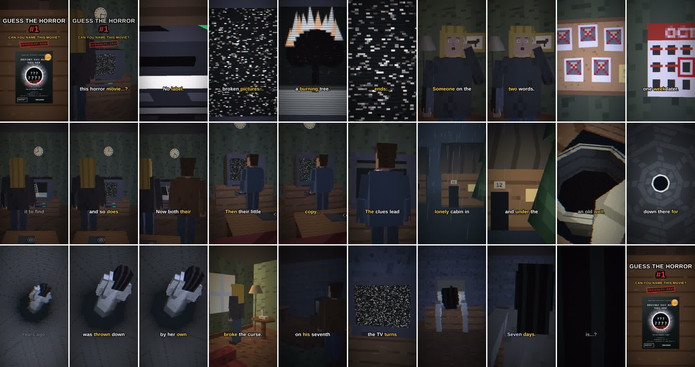
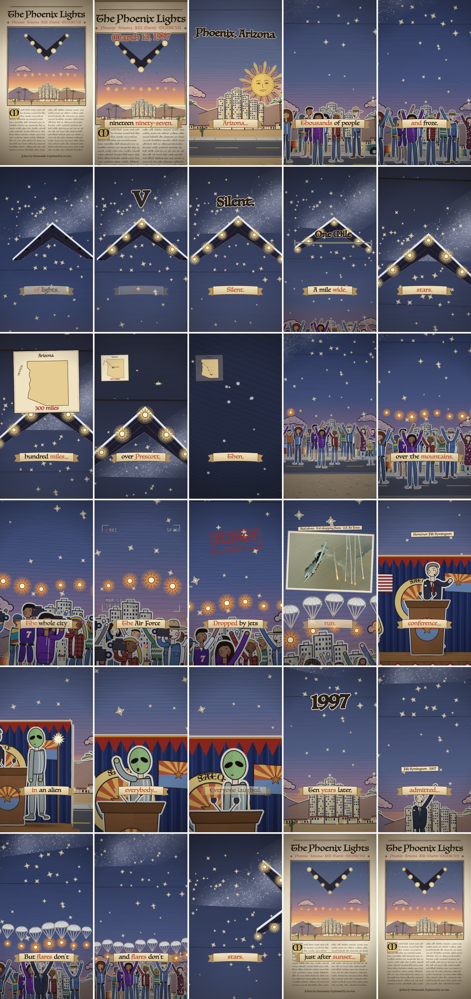
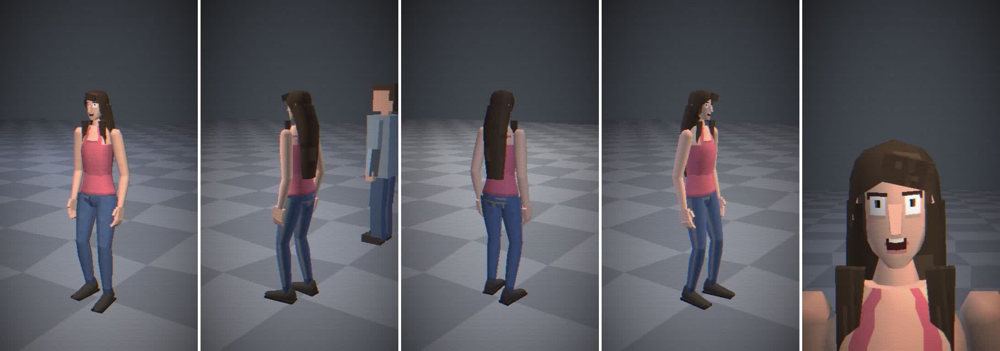
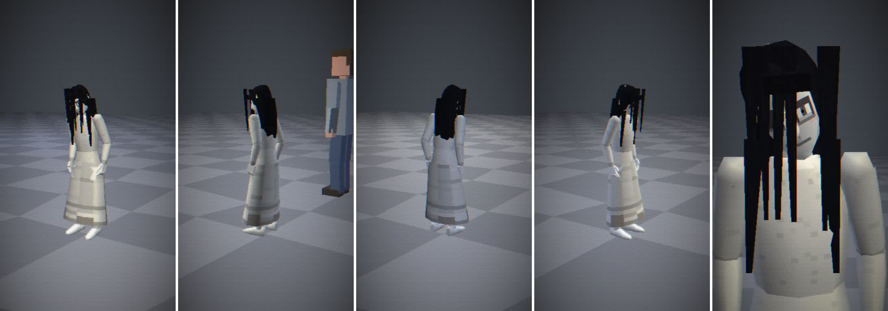
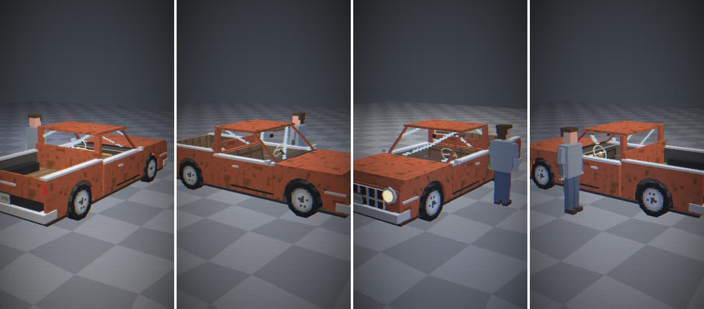
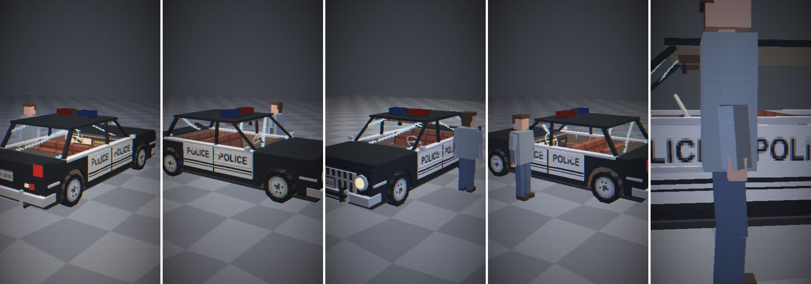
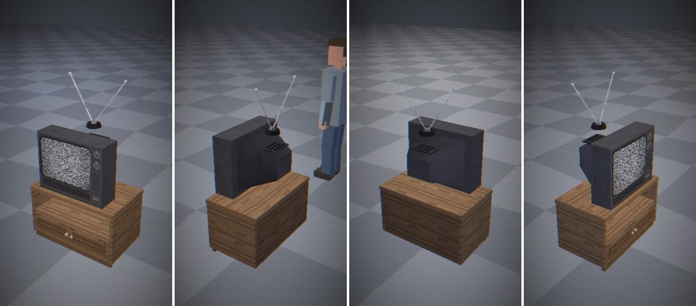
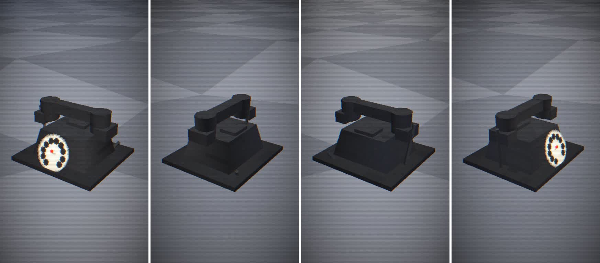
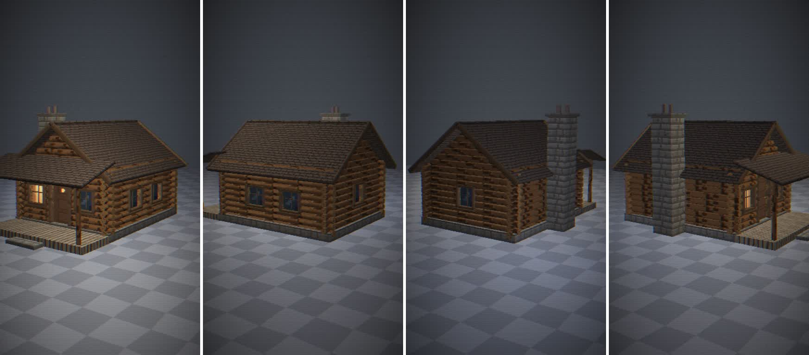
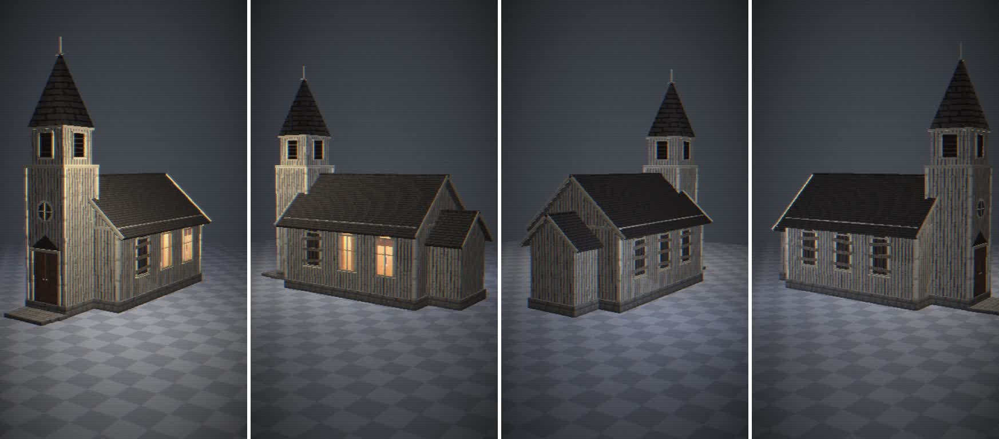

# 3dBlock Studio

**An MCP server that lets any AI make PS1-style low-poly 3D short videos.** Give your AI a story; it writes the script, voices it with ElevenLabs, builds the scene in three.js, and renders a vertical 1080x1920 video that loops perfectly. It ships with the engines, a prop library, an 11-role AI film crew and the render pipeline behind the *Guess The Horror* and *Strange History* channels.

<p align="center"> </p>

<!-- TODO showcase: a GIF wall of finished shorts goes here (The Hitchhiker, The Caller, The Cursed Tape, The Rusted Truck, Phoenix Lights) -->

## What it makes

- **PS1 low-poly 3D**: box people, tiny painted textures, vertex wobble, fog, per-vertex lighting, then real lenses (mm focal lengths, depth of field), bloom, flares, letterbox and colour grades on top.
- **Living woodcut broadsheets** for history stories.
- Narration with word-level timing, sound effects and an original score from ElevenLabs, mixed with the voice always on top and normalized to -14 LUFS.
- A seamless loop: the last frame is the first frame, and the audio tail crossfades onto the start.

## Install

You need **Node 18+** and **Google Chrome** (or Chromium/Edge). ffmpeg comes bundled. The renders run on your computer.

### Claude Desktop / Claude Code / Cursor / any MCP client

```json
{
  "mcpServers": {
    "3dblock-studio": {
      "command": "npx",
      "args": ["-y", "3dblock-studio-mcp"],
      "env": { "ELEVENLABS_API_KEY": "your key (optional: without it, renders are silent drafts)" }
    }
  }
}
```

Claude Code in one line: `claude mcp add 3dblock-studio -- npx -y 3dblock-studio-mcp`

From a clone: `npm install`, then point the client at `node /path/to/3dblock-studio-mcp/bin/3dblock-studio-mcp.mjs`.

| Setting | Default | What it does |
| --- | --- | --- |
| `BLOCK_STUDIO_HOME` | `~/3dBlockStudio` | Episodes, takes, render jobs and the audio cache |
| `ELEVENLABS_API_KEY` | none | Voice, sound effects, music. Or put the key in `~/.config/elevenlabs.key` |
| `CHROME_PATH` | auto-detected | Any Chrome, Chromium or Edge |
| `FFMPEG_PATH` | bundled | Use your own ffmpeg |
| `ELEVEN_FORMAT` | `mp3_44100_128` | `mp3_44100_192` on Creator plans and up |

## Your first episode in five prompts

1. *"Check the studio setup."* (`studio_info`)
2. *"Make a Guess The Horror short about a cursed videotape. Show me the script first."* (`make_episode` prompt: `new_episode`, writer brief, `write_file spec.js`)
3. *"Looks good, voice it and build the scene."* (`voice_lines`, `read_episode the-cursed-tape-ps1`, `get_engine_guide ps1`, `write_file scene.js`)
4. *"Show me stills."* (`render_stills`, `job_status` returns the contact sheet; the AI fixes what it sees)
5. *"Render a take and open it."* (`render_take`, `job_status`, `open_take`, then `pick_take` and `post_kit` when you like it)

## Tools

| Group | Tool | What it does |
| --- | --- | --- |
| Plan | `studio_info` | Studio folder, Chrome, ffmpeg, whether a key is set |
| Plan | `list_formats` | Series formats: engine, target length, rules |
| Plan | `get_house_rules` | The look, copyright rules, format playbook |
| Plan | `get_crew_brief` | One crew role's brief (director, writer, casting director, production designer, cinematographer, gaffer, script supervisor, editor, sound engineer, colorist, producer) |
| Plan | `get_engine_guide` | How the ps1, woodcut and timeline engines work, with their API |
| Write | `new_episode` | Episode folder from a template that renders as-is |
| Write | `list_episodes`, `read_episode`, `read_file` | Your episodes and the built-in examples |
| Write | `write_file` | Save `spec.js`, `scene.js` or a crew note; syntax-checked, spec validated, history kept |
| Library | `list_props` | People, furniture, places and vehicles builders with their options |
| Library | `preview_prop` | Render any prop from 4 angles next to a reference person |
| Sound | `list_voices` | Your ElevenLabs voices |
| Sound | `voice_lines` | Voice every line (cached by hash: unchanged lines are free), returns lengths |
| Shoot | `render_stills` | 30-frame contact sheet for a quick look |
| Shoot | `render_take` | The next numbered take: frames, mix, thumbnail, contact sheet, QC |
| Post | `job_status`, `list_jobs` | Render progress; finished jobs return their images |
| Post | `list_takes`, `qc_take` | Length, loudness, loop seam score, copyright checklist |
| Post | `pick_take`, `open_take` | Mark the FINAL; play a take on screen |
| Deliver | `post_kit` | Caption, up to 5 hashtags, song note, posting time |

**Prompts:** one per crew role (`/director`, `/colorist`, ...) plus `make_episode`. **Resources:** the house rules and the example episodes.

## The prop library

<p align="center">
   
   
</p>

## How it works

The AI only sends tool calls and code. On your machine the server voices the lines (ElevenLabs, cached), serves the scene to headless Chrome, steps time frame by frame (every scene is a pure function of `t`), pipes the frames to ffmpeg, mixes the audio with ducking and a loop crossfade, and writes the take next to its thumbnail and contact sheet.

```
episodes/<slug>/spec.js    the script, voice, music, sound cues (word-timed)
episodes/<slug>/scene.js   the three.js scene on the PS1 or woodcut engine
output/<series>/<NN - Title>/takes/<Title> - Take NN.mp4
```

## House rules (built in)

Retellings only, with original art, music and voices: no real posters, stills, clips, logos or theme music. Guessing formats never name the answer. No gore. Made-up brands only. Every take is numbered; only you pick the FINAL.

## License

MIT. ElevenLabs usage is billed to your own account.
